# Alafasy Quran (الأفاسي قرآن)

**Alafasy Quran** is an Android-first, 100% offline-centric mobile application built with **React Native (0.87)** and **TypeScript**. Designed with a tranquil, modern aesthetic, the app provides a seamless listening experience for all **114 Surahs of the Holy Quran**, recited by **Sheikh Mishary Rashid Alafasy**.

**Alafasy Quran**, Şeyh Meşari Raşid el-Afasi tarafından okunan **114 Kur'an-ı Kerim sûresini** %100 çevrimdışı (internet gerektirmeden) dinleme imkanı sunan, **React Native (0.87)** ve **TypeScript** ile geliştirilmiş Android öncelikli bir mobil uygulamadır.

The core technical highlight of this application is **100% offline asset delivery**: all 114 recitations (~322 MB of 24 kbps mono audio) are bundled and delivered locally using Android's **Play Asset Delivery (PAD)**, eliminating the need for streaming, internet access, or per-track downloads.

---

## 📱 Application Screenshots / Uygulama Ekran Görüntüleri

The application features full multi-language localization (**English**, **Turkish**, **Arabic**, and **French**). Below is a complete visual showcase of all application screens and pages in both **English** and **Turkish (Türkçe)**.

Uygulama **İngilizce**, **Türkçe**, **Arapça** ve **Fransızca** olmak üzere tam çoklu dil desteğine sahiptir. Aşağıda uygulamanın tüm sayfaları ve ekranları **İngilizce** ve **Türkçe** dillerinde görsel olarak sunulmuştur:

---

### 🇬🇧 English Screenshots

| Home Dashboard | Surah Library | Surah Search Filter |
| :---: | :---: | :---: |
| 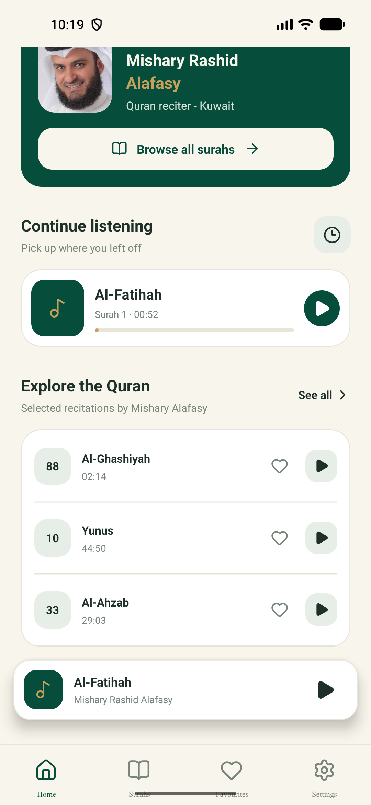 | 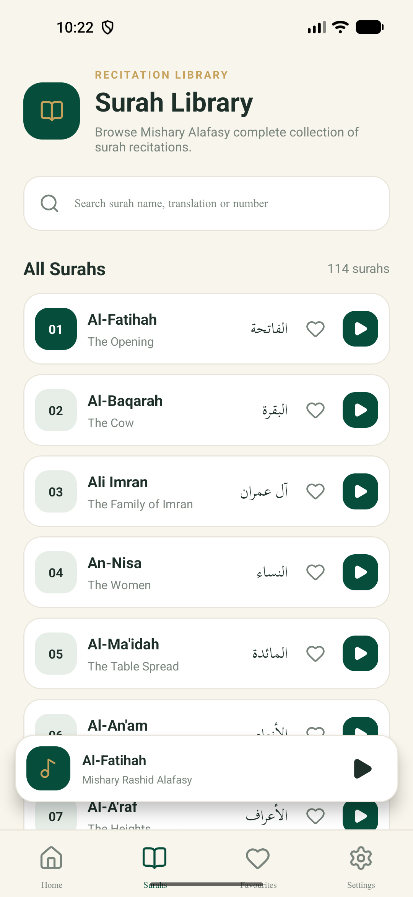 | 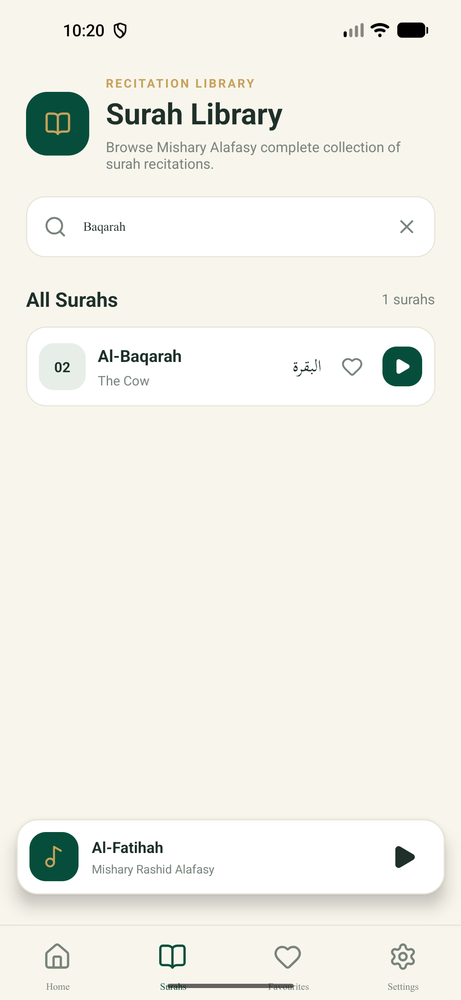 |
| **Home Dashboard**<br>Featured reciter profile, continue listening card, and quick recommendations. | **Surah Library**<br>Complete catalog of all 114 Surahs with English & Arabic titles. | **Smart Search**<br>Diacritic-insensitive Arabic, transliteration, and English search filtering. |

| Saved Favourites | Full Audio Player | App Settings |
| :---: | :---: | :---: |
| 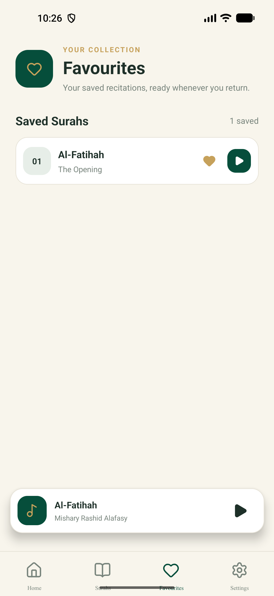 | 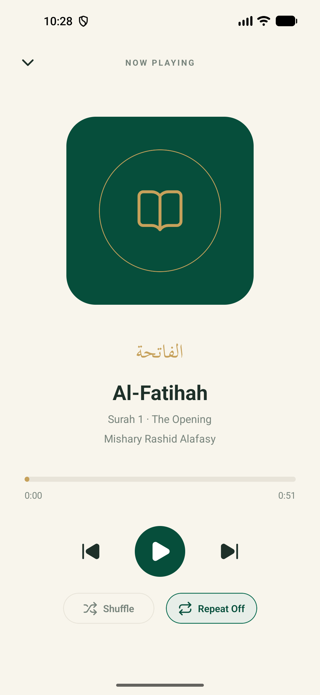 | 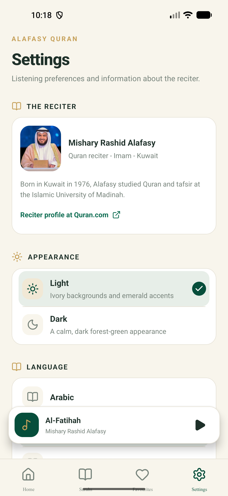 |
| **Favourites**<br>On-device saved favorite recitations list for instant access. | **Full Player Modal**<br>Interactive audio player with seekbar, repeat modes, and shuffle controls. | **Settings Page**<br>Dark/Light theme switcher, multi-language selector, and reciter bio. |

---

### 🇹🇷 Türkçe Ekran Görüntüleri

| Ana Sayfa Panel | Sûre Kütüphanesi | Sûre Arama Filtresi |
| :---: | :---: | :---: |
|  | 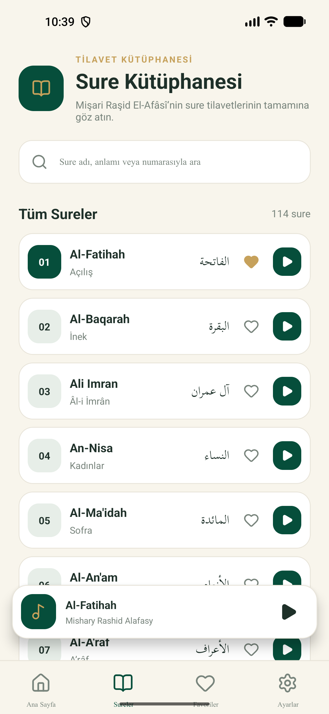 | 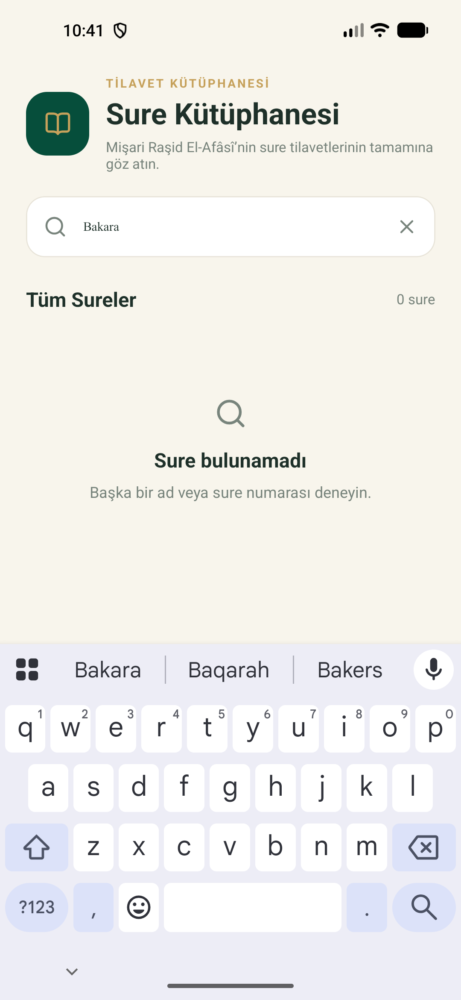 |
| **Ana Sayfa**<br>Öne çıkan hâfız profili, dinlemeye devam et kartı ve seçkin sûreler. | **Sûre Kütüphanesi**<br>114 Sûrenin tamamını içeren Türkçe anlamı ve Arapça başlıkları. | **Akıllı Arama**<br>Harekeli/harekesiz Arapça, okunuş ve Türkçe anlık sûre arama filtresi. |

| Favori Sûreler | Tam Oynatıcı Paneli | Ayarlar Sayfası |
| :---: | :---: | :---: |
| 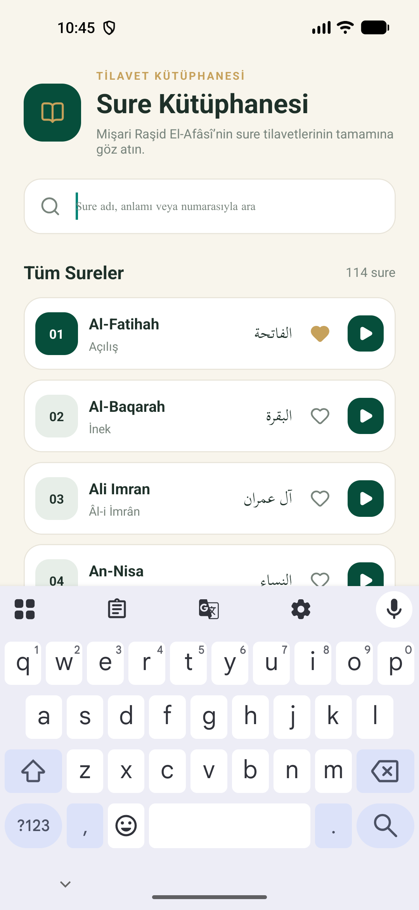 | 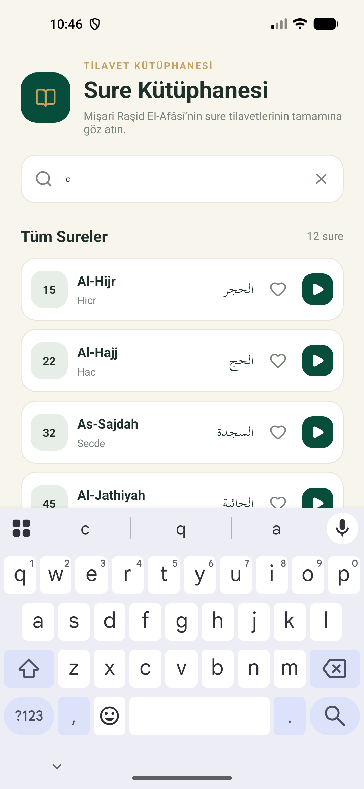 | 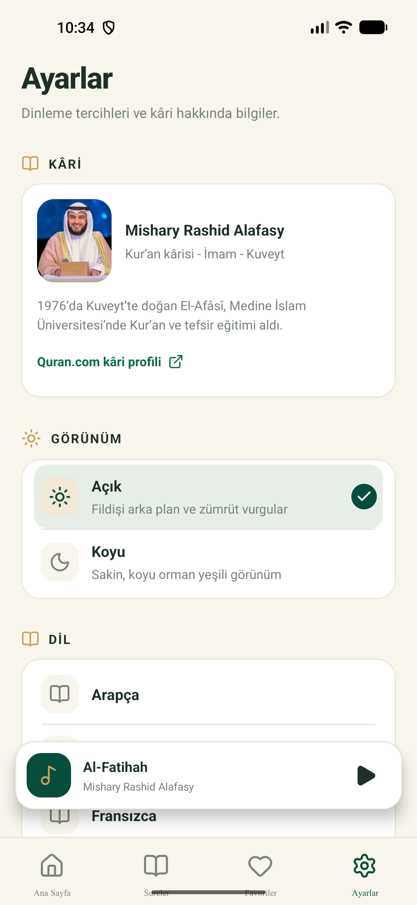 |
| **Favoriler**<br>Hızlı erişim için cihaz hafızasına kaydedilmiş favori sûreler listesi. | **Gelişmiş Oynatıcı**<br>İnteraktif kaydırma çubuğu, tekrar modları ve karışık çalma kontrolleri. | **Ayarlar**<br>Karanlık/Aydınlık tema tercihi, dil seçimi ve kâri hakkında bilgiler. |

---

## 🌟 Key Features / Öne Çıkan Özellikler

* **Complete Offline Library / Eksiksiz Çevrimdışı Kütüphane:** All 114 Surahs pre-packaged for immediate, internet-free playback. (114 Sûrenin tamamı internet gerektirmeden dinlenmek üzere paketlenmiştir.)
* **Smart Arabic Search / Akıllı Arama Motoru:** Intelligent search supporting transliterations, translations, Surah numbers, and **diacritic-insensitive (Tashkeel) Arabic queries** (e.g. `البقرة` matches `الْبَقَرَةُ`).
* **Advanced Playback Engine / Gelişmiş Oynatıcı:** Full playback controls with **Repeat Off** (silent rewind to 0:00), **Repeat One**, **Repeat All**, and **Shuffle** using an unbiased Fisher-Yates bag algorithm with history tracking.
* **Session Persistence / Oturum Kaydı:** Automatically persists and restores the active Surah, seek position, repeat mode, and shuffle state across app process restarts via `AsyncStorage`.
* **Multi-Language Support / Çoklu Dil Desteği:** Fully localized in **English**, **Turkish (Türkçe)**, **Arabic (العربية)**, and **French (Français)**.
* **Adaptive Theme & Inset Awareness / Uyumlu Tema ve Çentik Desteği:** Dual Light and Dark themes with dynamic Safe Area padding for notch and gesture navigation bar compatibility.

---

## 🏗️ Software Architecture & Design Principles

The application is engineered as a **Modular Monolith** using **Unidirectional Data Flow (UDF)** and a **Layered Separation of Concerns**:

```
Presentation Layer (Screens & Components)
         │
         ▼ (Consumes Context Hooks)
Application State Layer (React Contexts)
         │
         ▼ (Executes Domain Logic)
Domain / Service Layer (Audio State Machine & Persistence)
         │
         ▼ (Native Bridge Promises)
Infrastructure / Native Layer (Kotlin QuranAudioAssetsModule & TrackPlayer)
```

### Key Engineering Patterns Used
* **Observer Pattern:** React components and contexts subscribe to native `TrackPlayer` event streams (`PlaybackActiveTrackChanged`, `PlaybackProgressUpdated`, `PlaybackState`).
* **Adapter / Bridge Pattern:** `QuranAudioAssetsModule.kt` adapts Android's native `AssetManager` / Play Asset Delivery module into JavaScript Promises (`getSurahAssetUri`).
* **Strategy Pattern:** Discrete playback progression strategies for `Repeat Mode` (`off`, `one`, `all`).
* **Fisher-Yates Shuffle Bag:** $O(N)$ unbiased random selection algorithm with a backward navigation history stack.

### SOLID Principles Applied
* **Single Responsibility Principle (SRP):** UI components render views, Contexts manage shared reactive state, Services wrap player APIs, and Native modules resolve audio files.
* **Open/Closed Principle (OCP):** Localization and themes can be expanded without altering UI component logic.
* **Interface Segregation (ISP):** Components consume specific hooks (`useAudioPlayer()`, `useTheme()`, `useLocalization()`) rather than a monolithic global store.
* **Dependency Inversion (DIP):** UI screens depend on React Context abstractions rather than calling low-level native player APIs directly.

---

## 📂 Directory Structure

```text
AlafasyQuran/
├── android/                         # Native Android project configuration
│   ├── app/                         # Main application module (Manifest, Gradle, Kotlin source)
│   │   └── src/main/java/com/alafasyquran/
│   │       ├── MainActivity.kt      # Root Activity
│   │       ├── MainApplication.kt   # React Native Application entry
│   │       └── QuranAudioAssetsModule.kt # Native Kotlin bridge for asset access
│   └── quran_audio/                 # Install-time Play Asset Pack (322 MB audio files)
│       └── src/main/assets/audio/   # 114 converted MP3 files (001.mp3 .. 114.mp3)
├── docs/                            # Project documentation & screenshots
│   └── screenshots/                 # Application screenshots (English & Turkish)
│       ├── home_en.png              # Home dashboard screen (English)
│       ├── home_tr.png              # Home dashboard screen (Turkish)
│       ├── surahs_en.png            # Surah library list (English)
│       ├── surahs_tr.png            # Surah library list (Turkish)
│       ├── surahs_search_en.png     # Surah search results (English)
│       ├── surahs_search_tr.png     # Surah search results (Turkish)
│       ├── favourites_en.png        # Saved favourites screen (English)
│       ├── favourites_tr.png        # Saved favourites screen (Turkish)
│       ├── player_en.png            # Full audio player modal (English)
│       ├── player_tr.png            # Full audio player modal (Turkish)
│       ├── settings_en.png          # App settings screen (English)
│       └── settings_tr.png          # App settings screen (Turkish)
├── src/                             # Core TypeScript application logic
│   ├── components/                  # Reusable UI components
│   │   ├── AppText.tsx              # Custom text with selective Arabic font scaling
│   │   └── AudioPlayerOverlay.tsx   # Mini-player bar & full-screen modal player
│   ├── context/                     # Application state contexts (UDF)
│   │   ├── AudioPlayerContext.tsx   # Central audio player state provider
│   │   ├── FavouritesContext.tsx     # On-device favourite surahs state
│   │   ├── LocalizationContext.tsx  # Multi-language translation engine
│   │   └── ThemeContext.tsx         # Light / Dark theme palette provider
│   ├── data/                        # Static metadata
│   │   ├── surahs.ts                # Metadata for all 114 Surahs (Name, Arabic, Translation)
│   │   └── surahDurations.ts        # Pre-calculated audio durations
│   ├── screens/                     # Main top-level application screens
│   │   ├── HomeScreen.tsx           # Dashboard with reciter showcase & quick controls
│   │   ├── SurahsScreen.tsx         # Searchable Surah library
│   │   ├── FavouritesScreen.tsx     # Saved favorite recitations list
│   │   └── SettingsScreen.tsx       # Appearance, language, bio & app info
│   ├── services/                    # Domain logic & native library abstractions
│   │   ├── audioPlayer.ts           # TrackPlayer wrapper, repeat/shuffle algorithms
│   │   ├── playbackService.ts       # Headless background media controls listener
│   │   └── playbackSession.ts       # AsyncStorage session serialization/restore
│   └── theme/                       # Design system tokens and color palettes
├── __tests__/                       # Automated unit test suites (Jest)
│   ├── App.test.tsx                 # Root component render test
│   ├── audioPlayer.test.ts          # State machine, queue, repeat & shuffle unit tests
│   └── playbackSession.test.ts      # Storage serialization & restoration unit tests
└── index.js                         # React Native application entry point
```

---

## 🛠️ Tech Stack

* **Core:** React Native `0.87.1`, React `19.2.3`, TypeScript `6.0.3`
* **Navigation:** React Navigation `7.x` (Bottom Tabs & Native Stack)
* **Audio Engine:** `react-native-track-player` (`4.0.0-rc09` patched for RN 0.87 & Kotlin nullability)
* **Native Android:** Kotlin, Play Asset Delivery (PAD), Android AssetManager
* **Storage:** `@react-native-async-storage/async-storage`
* **Testing:** Jest & React Test Renderer

---

## 🚀 Getting Started / Başlangıç

### Prerequisites / Ön Gereksinimler

* Node.js `>= 22.11.0`
* Android Studio with Android SDK & NDK
* Android Device or Emulator connected via USB Debugging

### Installation / Kurulum

1. **Clone the repository & install dependencies:**
   ```sh
   npm install
   ```

2. **Start the Metro Bundler:**
   ```sh
   npm start
   ```

3. **Run on Android (Debug Mode):**
   ```sh
   npx react-native run-android
   ```

---

## 🧪 Testing / Testler

The project includes 100% passing automated unit tests covering state transitions, queue logic, shuffle algorithms, and session persistence.

```sh
npm test
```

---

## 📦 Building Standalone Release Mode (Production Performance)

### 1. Run & Install Release Mode directly on a phone:
```sh
npx react-native run-android --mode=release
```

### 2. Generate a Standalone Release APK (`app-release.apk`):
On Windows PowerShell:
```powershell
cd android
.\gradlew assembleRelease
```
The resulting APK will be generated at:
`android/app/build/outputs/apk/release/app-release.apk`

---

## 📜 License & Credits

* **Audio Reciter:** Sheikh Mishary Rashid Alafasy (Source: [MP3Quran.net](https://www.mp3quran.net/eng/afs))
* **Developer:** Developed with care by **AMTILYST**.
